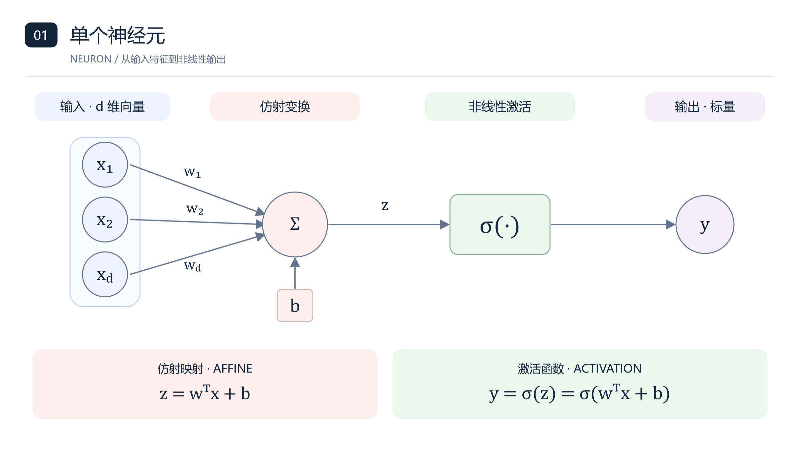
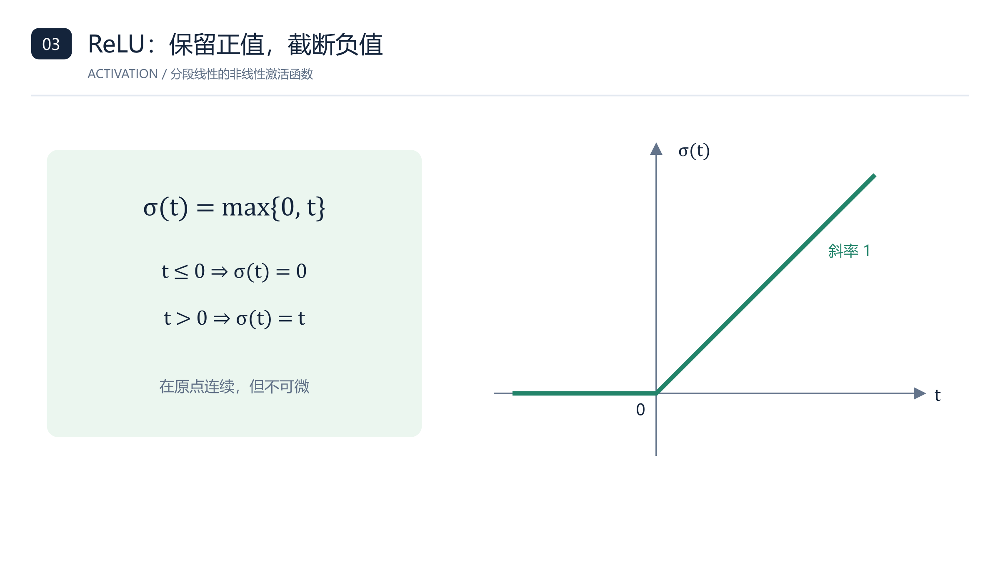
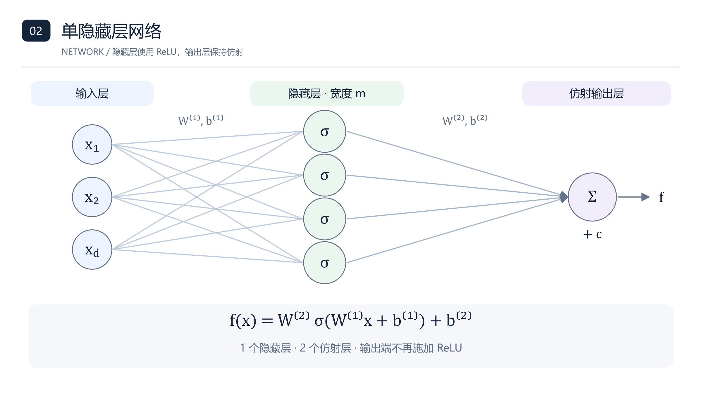
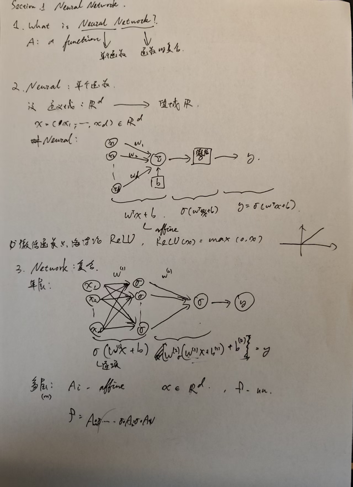
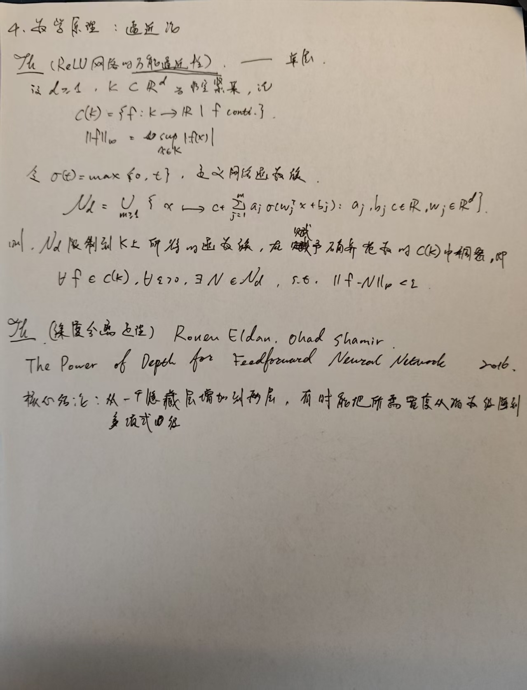

# 神经网络：从神经元到逼近理论

> 根据两页手写笔记整理，保留原有四部分结构与主要公式。在原笔记基础上，补入函数与参数、非线性的作用、层数约定、定理适用范围及文献依据。原图中输出激活与层数计数不够明确，本文采用下述统一约定。
>
> **统一约定：**隐藏层逐坐标使用 ReLU，输出层为仿射映射；输入层不计入深度。“单隐藏层”包含两个仿射层。

## 1. 什么是神经网络？

从数学上看，神经网络是一个由参数确定的函数。

- **神经元（neuron）：**基本计算单元。
- **网络（network）：**将多个计算单元组织起来，通过映射的复合构造函数。

本文主要讨论从 $\mathbb{R}^d$ 到 $\mathbb{R}$ 的前馈神经网络。

**函数与参数。**将网络中的全部权重与偏置统一记为参数 $\theta$。固定结构和参数，就得到一个具体函数 $f_\theta$；改变参数，就得到函数族

$$
\mathcal{F}=\{f_\theta:\theta\in\Theta\},
$$

其中 $\Theta$ 是该结构对应的参数空间。网络的**表达能力**描述这个函数族能够表示哪些函数，**逼近能力**描述它能够以多小的误差逼近目标函数。训练则是根据数据选择参数的过程。因此，“存在一个好的网络”与“能够通过训练找到它”是两个不同的问题。

## 2. 单个神经元

设输入为列向量

$$
x=(x_1,\ldots,x_d)^\top\in\mathbb{R}^d.
$$

给定权重 $w\in\mathbb{R}^d$、偏置 $b\in\mathbb{R}$ 和激活函数 $\sigma:\mathbb{R}\to\mathbb{R}$，神经元计算

$$
z=w^\top x+b=\sum_{i=1}^d w_i x_i+b,
\qquad y=\sigma(z).
$$

其中 $x\mapsto w^\top x+b$ 是**仿射映射**。原笔记采用的 ReLU 激活函数为

$$
\sigma(t)=\operatorname{ReLU}(t)=\max\{0,t\}
=\begin{cases}0,&t\le0,\\t,&t>0.\end{cases}
$$

*图 1：神经元先计算仿射映射，再施加激活函数。*

*图 2：ReLU 的分段线性结构。*

**非线性的作用。**设 $A_1(x)=W_1x+b_1$、$A_2(z)=W_2z+b_2$，则

$$
A_2(A_1(x))
=W_2(W_1x+b_1)+b_2
=(W_2W_1)x+(W_2b_1+b_2).
$$

右侧仍是仿射映射。反复使用这一结论可知，任意多个仿射层的复合都可以合并成一个仿射层。因此，如果中间没有非线性激活，仅增加仿射层数不能超出仿射函数族。ReLU 虽然在正、负半轴上分别是线性的，但在整个实轴上不是仿射函数，这使网络能够构造更丰富的函数。

## 3. 网络：映射的复合

### 3.1 单隐藏层网络

设隐藏层宽度为 $m$，取

$$
W^{(1)}\in\mathbb{R}^{m\times d},\qquad b^{(1)}\in\mathbb{R}^m.
$$

隐藏层输出为

$$
h(x)=\sigma\!\left(W^{(1)}x+b^{(1)}\right)\in\mathbb{R}^m.
$$

这里的 $\sigma$ **逐坐标作用**：$\sigma(v)=(\sigma(v_1),\ldots,\sigma(v_m))^\top$。

取 $W^{(2)}\in\mathbb{R}^{1\times m}$、$b^{(2)}\in\mathbb{R}$，输出层采用仿射映射，得到

$$
\boxed{f(x)=W^{(2)}\sigma\!\left(W^{(1)}x+b^{(1)}\right)+b^{(2)}.}
$$

令 $W^{(1)}$ 的第 $j$ 行为 $w_j^\top$，$b^{(1)}$ 的第 $j$ 个分量为 $b_j$，并记 $W^{(2)}=(a_1,\ldots,a_m)$、$b^{(2)}=c$，则

$$
\boxed{f(x)=c+\sum_{j=1}^m a_j\sigma(w_j^\top x+b_j).}
$$

*图 3：示意图取三个输入、四个隐藏神经元；一般情形为 $d$ 个输入、$m$ 个隐藏神经元。隐藏节点使用 ReLU，输出节点计算加权和并加偏置。*

**输出层是否加激活？**两种结构在数学上都合法，但适用范围不同。若输出端再加 ReLU，则输出恒非负，不能逼近任意实值连续函数。例如，在非空集合 $K$ 上取目标函数 $f(x)\equiv-1$。若 $N(x)\ge0$，则对每个 $x\in K$ 都有

$$
|f(x)-N(x)|=|-1-N(x)|=1+N(x)\ge1,
$$

所以 $\|f-N\|_\infty\ge1$，误差不可能任意小。因此，为与第 4 部分对任意实值连续函数的逼近结论一致，本文采用仿射输出层。

### 3.2 多隐藏层网络

设网络有 $L$ 个仿射层，层宽为

$$
n_0=d,\quad n_1,\ldots,n_{L-1},\quad n_L=1.
$$

定义

$$
A_\ell:\mathbb{R}^{n_{\ell-1}}\to\mathbb{R}^{n_\ell},
\qquad A_\ell(z)=W^{(\ell)}z+b^{(\ell)},
$$

其中 $W^{(\ell)}\in\mathbb{R}^{n_\ell\times n_{\ell-1}}$、$b^{(\ell)}\in\mathbb{R}^{n_\ell}$。对 $L\ge2$，网络为

$$
\boxed{f=A_L\circ\sigma\circ A_{L-1}\circ\cdots\circ\sigma\circ A_1.}
$$

复合从右向左计算，各处 $\sigma$ 逐坐标作用于对应的隐藏层空间。等价地，

$$
h^{(0)}=x,\qquad
h^{(\ell)}=\sigma\!\left(W^{(\ell)}h^{(\ell-1)}+b^{(\ell)}\right),
\quad1\le\ell\le L-1,
$$

$$
f(x)=W^{(L)}h^{(L-1)}+b^{(L)}.
$$

**层数计数。**上述网络有 $L-1$ 个隐藏层、$L$ 个仿射层。原笔记的“单层”统一写成“单隐藏层”，对应 $L=2$。为避免与宽度 $m$ 混淆，用 $L$ 表示仿射层数；$L=1$ 时约定 $f=A_1$。

## 4. 数学原理：逼近论

### 4.1 ReLU 网络的万能逼近性

设 $d\ge1$，$K\subset\mathbb{R}^d$ 为非空紧集。记

$$
C(K)=\{f:K\to\mathbb{R}\mid f\text{ 连续}\},
\qquad \|f\|_\infty=\sup_{x\in K}|f(x)|.
$$

取 $\sigma(t)=\max\{0,t\}$，定义单隐藏层网络函数族

$$
\mathcal{N}_d=\bigcup_{m\ge1}\left\{
x\longmapsto c+\sum_{j=1}^m a_j\sigma(w_j^\top x+b_j)
\;\vert\;a_j,b_j,c\in\mathbb{R},\ w_j\in\mathbb{R}^d
\right\}.
$$

**定理（ReLU 单隐藏层网络的万能逼近性）。**将 $\mathcal{N}_d$ 中的函数限制在 $K$ 上，所得函数族在一致范数下稠密于 $C(K)$。即

$$
\forall f\in C(K),\quad\forall\varepsilon>0,\quad
\exists N\in\mathcal{N}_d,\qquad
\sup_{x\in K}|f(x)-N(x)|<\varepsilon.
$$

**文献依据。**ReLU 连续且不是整个实轴上的多项式，故适用连续非多项式激活函数的万能逼近结果。参见 Leshno、Lin、Pinkus 与 Schocken（1993）的[原论文](https://pinkus.net.technion.ac.il/files/2021/02/neural.pdf)。此处仅使用其连续激活函数情形。

**定理的边界。**宽度可以随目标函数和误差要求改变。定理没有给出一个固定宽度适用于所有目标的保证，也没有保证某种训练算法一定找到相应参数。它是存在性结论。

### 4.2 深度分离

原笔记引用：Ronen Eldan 与 Ohad Shamir，**The Power of Depth for Feedforward Neural Networks**，2016，COLT，PMLR 49:907–940。[论文及下载入口](https://proceedings.mlr.press/v49/eldan16.html)。

原笔记的核心意思可严谨表述为：**对于某些函数及特定逼近要求，两个隐藏层的网络可以用关于输入维数的多项式规模实现逼近，而一个隐藏层的网络达到同等级精度可能需要指数规模。**这是一种存在性结论，不是所有函数都能通过增加深度获得指数收益。

**与万能逼近性的关系。**万能逼近性讨论“是否存在足够宽的网络”，深度分离讨论“需要多大的网络”。浅层网络能够逼近，并不意味着它能高效地逼近。

**层数与误差标准。**该论文将仿射输出层计入层数，其二层、三层网络分别对应本文的一个、两个隐藏层。其分离结论使用构造的概率分布下的平方积分误差，与上一节任意紧集上的一致误差不同。此处保留定性结论；精确假设和定量常数见原论文定理 1。

### 原始手写笔记（供核对）

*原图第 1 页：第 1—3 部分。*

*原图第 2 页：第 4 部分。*
