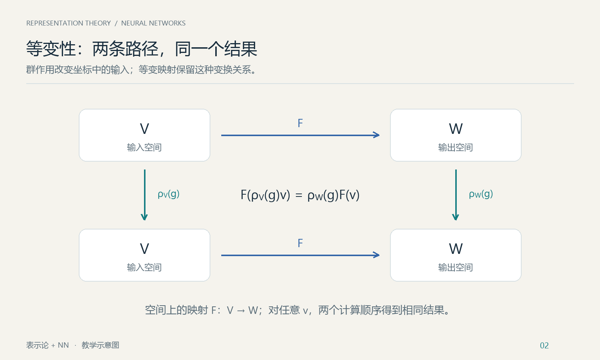
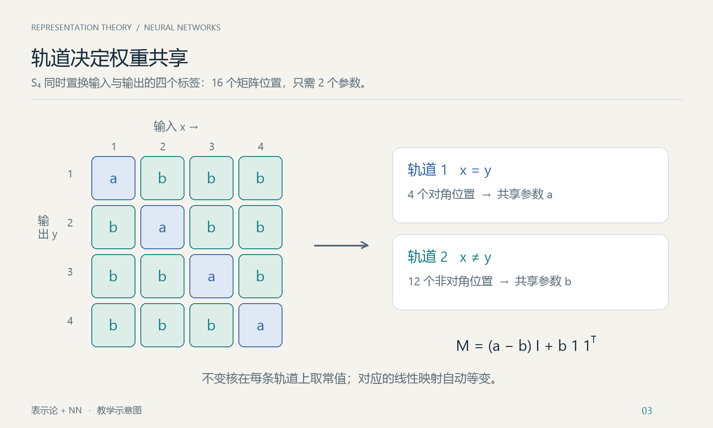
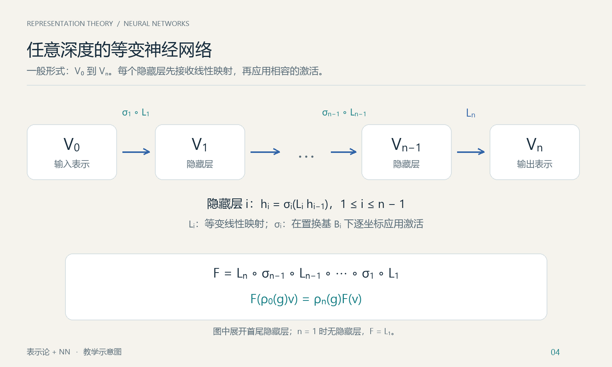

# 表示论与等变神经网络

## 从群对称性到等变神经网络

> **参考文献**：Joel Gibson、Daniel Tubbenhauer、Geordie Williamson，*Equivariant Neural Networks and Piecewise Linear Representation Theory*，**arXiv:2408.00949v2**，2024 年 12 月 20 日版本。本文主要参考该论文第 2A、2D、2E 节，按“群表示与等变映射 → 等变线性映射 → 置换表示与非线性激活 → 网络构造”的教学顺序重新组织。
>
> [论文 v2 页面](https://arxiv.org/abs/2408.00949v2) · [论文 v2 PDF](https://arxiv.org/pdf/2408.00949v2) · [论文 v2 HTML](https://arxiv.org/html/2408.00949v2)

**整理说明。** 本讲义以修订讲义为底稿，保留其中的证明、示例和适用范围说明，并对照所引论文 v2 核对定义与编号。讲义编号独立于论文编号；定理 4.2 是讲义中的构造性总结，并非论文的编号定理。

全文默认 $`G`$ 是有限群，向量空间均为有限维实向量空间，群作用均为左作用。主体讨论不含偏置的网络；偏置的允许条件另行说明。

---

## 1. 群表示与等变映射

### 1.1 为什么把表示论引入神经网络？

**直观例子：分类、定位与分子预测**


*图 1：用户提供的应用示意图。阅读时应区分中间特征的等变性与最终输出的不变性。*

图中三种任务的输出遵循不同的变换规则：

- **杯子分类**：图像旋转后，类别标签仍为“杯子”，所以分类标签是旋转不变输出。网络内部的空间特征可以随旋转而等变，最终再由不变读出得到类别。
- **猫的位置热图**：输入图像中的猫平移，输出热图的峰值随之平移，这是平移等变输出。实际离散图像还需明确平移范围、边界处理和采样方式。
- **分子性质预测**：在相同物理条件下，整体旋转分子不改变其标量能量，因此能量是旋转不变输出；若预测的是每个原子的力向量，则这些向量应随分子一起旋转，属于旋转等变输出。图中的能量数值仅作示意。

一般等变性要求输出按指定表示变化；当输出表示平凡时，就得到不变性。因此，图中“同样的变换”应理解为输入和输出分别遵循各自规定的群作用。三维任意旋转涉及的连续群超出本文主体的有限群设定；这里用于说明一般概念，不作为定理 4.2 的直接应用。

设网络实现映射 $`F:V\to W`$。如果输入具有某种对称性，希望对输入作对称变换后，输出也按预定方式变化。把输入、输出上的变换分别记为 $`\rho_V(g)`$ 和 $`\rho_W(g)`$，目标是

```math
F\bigl(\rho_V(g)v\bigr)=\rho_W(g)F(v)
\qquad(g\in G,\ v\in V).
```

这就是**等变性**：先变换输入再计算，与先计算再变换输出，结果相同。



*图 2：横向为同一个映射 $`F`$，纵向为输入和输出各自的群作用；交换性要求两条路径一致，并不要求 $`F`$ 线性。*

### 1.2 群表示

**定义 1.1（群表示）。** 群 $`G`$ 在 $`V`$ 上的实表示是群同态

```math
\rho_V:G\longrightarrow\mathrm{GL}(V).
```

即 $`\rho_V(e)=\mathrm{id}_V`$ 且 $`\rho_V(gh)=\rho_V(g)\rho_V(h)`$。常记

```math
g\cdot v:=\rho_V(g)v.
```

表示规定群元素如何通过可逆线性映射作用在向量空间上。不同层可以使用不同表示，维数也可以不同。

### 1.3 等变性的一般定义

**定义 1.2（等变映射）。** 设 $`V,W`$ 是 $`G`$-表示。映射 $`F:V\to W`$ 称为 $`G`$-等变映射，如果

```math
F(g\cdot v)=g\cdot F(v)
\qquad\forall g\in G,\ v\in V.
```

这里**不要求 $`F`$ 线性**。如果一个神经网络实现的函数满足此式，就说它在输入、输出的给定群作用下具有等变性。

当输出作用平凡，即 $`\rho_W(g)=\mathrm{id}_W`$ 时，等变性变为

```math
F(g\cdot v)=F(v),
```

此时称 $`F`$ 为 $`G`$-不变映射。

**命题 1.3（等变映射的复合）。** 若 $`F:U\to V`$ 和 $`H:V\to W`$ 均等变，则 $`H\circ F`$ 等变。

**证明。** 对任意 $`g\in G,u\in U`$，

```math
(H\circ F)(g\cdot u)
=H\bigl(g\cdot F(u)\bigr)
=g\cdot H(F(u))
=g\cdot(H\circ F)(u).
```

证毕。

这一简单事实是逐层构造等变网络的逻辑基础。一般等变性定义并不要求各层都是置换表示；论文 **Definition 2E.1** 选择的具体网络类别将在第 4 节讨论。

## 2. 线性部分：等变线性映射与不变核

### 2.1 交织算子空间 $`\mathrm{Hom}_G(V,W)`$

**定义 2.1。** 记

```math
\mathrm{Hom}_G(V,W)
:=
\left\{L\in\mathrm{Hom}_{\mathbb R}(V,W):
L\rho_V(g)=\rho_W(g)L\quad\forall g\in G\right\}.
```

其中的元素称为**等变线性映射**或**交织算子**。条件也可写作

```math
L(g\cdot v)=g\cdot L(v).
```

它们构成实向量空间。若 $`L_1,\dots,L_r`$ 是其一组基，则任意允许的线性层可写为

```math
L_\theta=\sum_{a=1}^{r}\theta_aL_a,
\qquad\theta_a\in\mathbb R.
```

这样，训练参数改变时，等变性仍由参数化方式自动保证。

### 2.2 为核函数描述准备函数空间

为先讲清线性层，这里先引入后文置换表示所需的函数空间模型。

设 $`X`$ 是有限左 $`G`$-集：$`X`$ 是带有左 $`G`$-作用的有限集合，**不必是一个群**。令

```math
\mathrm{Fun}(X,\mathbb R)=\{f:X\to\mathbb R\}.
```

对 $`x\in X`$，定义指示函数

```math
\delta_x(z)=
\begin{cases}
1,&z=x,\\
0,&z\ne x.
\end{cases}
```

则 $`\{\delta_x:x\in X\}`$ 是一组基，$`\dim\mathrm{Fun}(X,\mathbb R)=|X|`$，且

```math
f=\sum_{x\in X}f(x)\delta_x.
```

按论文 **Definition 2A.2**，在此空间定义

```math
(g\cdot f)(x)=f(g^{-1}\cdot x).
```

逆元保证这是左作用：

```math
\bigl(g\cdot(h\cdot f)\bigr)(x)
=f(h^{-1}g^{-1}x)
=f((gh)^{-1}x)
=((gh)\cdot f)(x).
```

特别地，$`g\cdot\delta_x=\delta_{gx}`$。因此群作用只是在置换这组基；第 3 节再利用这一性质处理激活函数。

### 2.3 不变核与线性层的对应（论文 Lemma 2E.3）

对有限 $`G`$-集 $`X,Y`$，在 $`X\times Y`$ 上取对角作用

```math
g\cdot(x,y)=(gx,gy).
```

定义

```math
\mathrm{Fun}_G(X\times Y,\mathbb R)
=\{K:X\times Y\to\mathbb R:
K(gx,gy)=K(x,y)\quad\forall g,x,y\}.
```

这里下标 $`G`$ 表示函数在对角作用下**不变**。

**定理 2.2（核函数同构）。** 有自然的实向量空间同构

```math
\boxed{
\mathrm{Hom}_G\bigl(\mathrm{Fun}(X,\mathbb R),
\mathrm{Fun}(Y,\mathbb R)\bigr)
\cong\mathrm{Fun}_G(X\times Y,\mathbb R).
}
```

**证明。** 分别构造两个方向的映射。

**第一步：由不变核得到等变线性映射。** 给定 $`K`$，令

```math
(L_Kf)(y):=\sum_{x\in X}K(x,y)f(x).
```

这显然关于 $`f`$ 线性。以 $`x=gz`$ 换元，得到

```math
\begin{aligned}
L_K(g\cdot f)(y)
&=\sum_{x\in X}K(x,y)f(g^{-1}x)\\
&=\sum_{z\in X}K(gz,y)f(z)\\
&=\sum_{z\in X}K(z,g^{-1}y)f(z)\\
&=(L_Kf)(g^{-1}y)\\
&=(g\cdot L_Kf)(y).
\end{aligned}
```

第三个等号利用核的不变性。因此 $`L_K`$ 等变。

**第二步：由等变线性映射得到不变核。** 给定 $`L`$，定义

```math
K_L(x,y):=(L\delta_x)(y).
```

由 $`\delta_{gx}=g\cdot\delta_x`$ 以及 $`L`$ 等变，

```math
\begin{aligned}
K_L(gx,gy)
&=(L\delta_{gx})(gy)\\
&=\bigl(L(g\cdot\delta_x)\bigr)(gy)\\
&=\bigl(g\cdot L\delta_x\bigr)(gy)\\
&=(L\delta_x)(y)=K_L(x,y).
\end{aligned}
```

**第三步：验证互逆。** 对任意 $`f`$，

```math
(L_{K_L}f)(y)
=\sum_x(L\delta_x)(y)f(x)
=\left[L\left(\sum_xf(x)\delta_x\right)\right](y)
=(Lf)(y).
```

另一方面，

```math
K_{L_K}(x,y)
=(L_K\delta_x)(y)
=\sum_{z\in X}K(z,y)\delta_x(z)
=K(x,y).
```

两方向都保持加法和数乘，故为实向量空间同构。证毕。

### 2.4 轨道给出权重共享方式

设对角作用的轨道为 $`\mathcal O_1,\dots,\mathcal O_r`$。不变核恰好是在每条轨道上取常值的函数，所以

```math
K=\sum_{a=1}^{r}\theta_a\mathbf1_{\mathcal O_a},
\qquad
\dim\mathrm{Hom}_G(\mathrm{Fun}(X,\mathbb R),
\mathrm{Fun}(Y,\mathbb R))=r.
```

在矩阵约定“列对应输入 $`x`$、行对应输出 $`y`$”下，$`M_{y,x}=K(x,y)`$。同一轨道中的矩阵元素共享参数。



*图 3：以 $`S_4`$ 同时置换四个输入、输出坐标为例，坐标对只有“相同”和“不同”两条轨道，所以等变矩阵只有两个自由参数。*

**讲义示例。** 对 $`n\ge2`$，令 $`S_n`$ 自然作用在 $`\{1,\dots,n\}`$ 上。两条轨道是 $`x=y`$ 与 $`x\ne y`$，因而

```math
(Lf)_i=a f_i+b\sum_{j\ne i}f_j,
\qquad
M=(a-b)I+b\mathbf1\mathbf1^{\mathsf T}.
```

对有限直和，线性层由各分量之间的等变块组成：

```math
L=(L_{kj}),\qquad
L_{kj}\in\mathrm{Hom}_G(U_j,W_k).
```

每一块都可以用上述不变核参数化。

## 3. 非线性部分：置换表示与逐坐标激活

### 3.1 置换表示及其基（论文 Definition 2A.2）

第 2.2 节的 $`\mathrm{Fun}(X,\mathbb R)`$ 连同作用 $`(g\cdot f)(x)=f(g^{-1}x)`$，称为由 $`X`$ 得到的**置换表示**。

等价地，若 $`V`$ 有一组基 $`B=\{b_1,\dots,b_d\}`$，群作用将 $`B`$ 作为集合置换，即

```math
g\cdot b_i=b_{\pi_g(i)}
```

其中 $`\pi_g`$ 是一个排列，则 $`V`$ 是置换表示。称这样的基为**置换基**。

“$`V`$ 与某个置换表示同构”是表示本身的性质；“在某组指定基中逐坐标应用激活”还涉及基的选择。不能从前者直接推出在任意基中定义的激活都等变。

### 3.2 凸多面体与分段线性映射

**定义 3.1（对应论文 Definition 2D.1）。** 本讲义按论文的覆盖约定，使用由有限个闭半空间相交得到、具有非空内部的凸多面体。若有限族 $`A_1,\dots,A_m`$ 满足

```math
V=\bigcup_{j=1}^{m}A_j,
```

就称其为 $`V`$ 的一个多面体覆盖。各块可以在边界上相交。

**定义 3.2（对应论文 Definition 2D.2）。** 若存在上述覆盖，使映射 $`f:V\to W`$ 在每个 $`A_j`$ 上都可写为

```math
f(v)=M_jv+c_j\qquad(v\in A_j),
```

其中 $`M_j`$ 线性、$`c_j\in W`$，则称 $`f`$ 为**分段线性映射**。

**术语提醒。** 论文的 piecewise linear 允许各段是仿射映射；一些教材将这种情形称为“分段仿射”。本讲义沿用论文术语。在重叠处，各公式必须给出同一个函数值。由于覆盖有限且各块闭，这样的映射连续。

手稿中的两个例子为

```math
\mathrm{ReLU}(t)=\max(0,t)
=\begin{cases}0,&t\le0,\\t,&t\ge0,\end{cases}
\qquad
\mathrm{Abs}(t)=|t|
=\begin{cases}-t,&t\le0,\\t,&t\ge0.\end{cases}
```

两者均非线性、分段线性，且都不是奇函数。

### 3.3 逐坐标激活依赖于基（论文 Definition 2D.8）

设 $`\sigma:\mathbb R\to\mathbb R`$ 是标量激活函数，固定 $`V`$ 的基 $`B=\{b_1,\dots,b_d\}`$，定义

```math
\sigma_B\left(\sum_{i=1}^{d}t_i b_i\right)
:=\sum_{i=1}^{d}\sigma(t_i)b_i.
```

当 $`\sigma=\mathsf{PL}`$ 是论文 Notation 2D.7 所使用的非线性分段线性函数时，这就是论文 **Definition 2D.8** 的 $`\mathsf{PL}_B`$。

此处“逐坐标”要求先明确坐标基。任意换基通常会改变该映射。在函数空间的指示函数基下，它可直接写成

```math
(\sigma_Xf)(x)=\sigma(f(x)).
```

### 3.4 置换作用与逐坐标激活可交换

**命题 3.3。** 若 $`B`$ 是置换基，则对任意标量函数 $`\sigma`$，在所有坐标上使用同一个 $`\sigma`$ 得到的 $`\sigma_B`$ 都是 $`G`$-等变的。

**证明。** 写 $`v=\sum_i t_i b_i`$，并设 $`g\cdot b_i=b_{\pi_g(i)}`$，则

```math
\begin{aligned}
\sigma_B(g\cdot v)
&=\sigma_B\left(\sum_i t_i b_{\pi_g(i)}\right)\\
&=\sum_i\sigma(t_i)b_{\pi_g(i)}\\
&=g\cdot\left(\sum_i\sigma(t_i)b_i\right)
=g\cdot\sigma_B(v).
\end{aligned}
```

证毕。

在函数空间中，同一证明只有一行：

```math
\sigma_X(g\cdot f)(x)
=\sigma(f(g^{-1}x))
=(g\cdot\sigma_Xf)(x).
```

**推论 3.4。** 在置换基下，逐坐标 ReLU 是 $`G`$-等变的。这个充分性结论不需要调用论文 Theorem 2E.7 的必要性方向。

上述交换性质本身不要求 $`\sigma`$ 分段线性。若不同坐标使用不同激活，则至少应保证被群作用相互置换的坐标使用相同函数。

### 3.5 为什么置换表示自然出现？（论文 Theorem 2E.7）

论文 **Theorem 2E.7** 在其有限群及非线性分段线性激活的语境下，陈述了如下判别：当 $`\mathsf{PL}`$ 不是奇函数时，

```math
\begin{gathered}
\text{存在一组基 }B\text{，使 }\mathsf{PL}_B:V\to V\text{ 等变}\\
\Longleftrightarrow\\
V\text{ 与某个置换表示同构。}
\end{gathered}
```

这里“不是奇函数”表示并非对所有 $`t`$ 都有 $`\mathsf{PL}(-t)=-\mathsf{PL}(t)`$。引用时必须保留论文的激活函数背景，不能把条件缩写为“任意非奇函数”。本文实际构造使用 ReLU；下面给出该情形的完整证明。

**ReLU 情形的证明。** 充分性已由命题 3.3 得到。反过来，设 $`\mathrm{ReLU}_B`$ 等变，考察其不动点集

```math
C=\left\{\sum_i t_i b_i:t_i\ge0\right\}
=\{v:\mathrm{ReLU}_B(v)=v\}.
```

若 $`v\in C`$，等变性给出

```math
\mathrm{ReLU}_B(gv)=g\mathrm{ReLU}_B(v)=gv,
```

故 $`gC\subseteq C`$；再对 $`g^{-1}`$ 应用相同论证，得 $`gC=C`$。可逆线性映射将锥的极射线映到极射线，而这个锥的极射线恰是 $`\mathbb R_{\ge0}b_i`$。因此

```math
gb_i=c_{g,i}b_{\pi_g(i)},\qquad c_{g,i}>0.
```

取任意正定内积 $`(\ ,\ )_0`$，对有限群平均，得到 $`G`$-不变正定内积

```math
\langle u,v\rangle_G
=\frac1{|G|}\sum_{g\in G}(gu,gv)_0.
```

令 $`b_i'=b_i/\|b_i\|_G`$。因为 $`g`$ 保持此范数，$`gb_i'`$ 是目标射线上长度为 $`1`$ 的正向向量，故

```math
gb_i'=b_{\pi_g(i)}'.
```

于是 $`G`$ 置换新基 $`\{b_i'\}`$，$`V`$ 与置换表示同构。证毕。

**结论的边界。** 上述必要性讨论的是“同一个标量激活在某组基下逐坐标作用”的特殊形式，不是对所有等变非线性映射的分类。它也不保证最初的基 $`B`$ 已经是置换基；ReLU 情形可能还需要正比例缩放。最终网络定理只用命题 3.3 的充分性。

## 4. 等变神经网络的构造与证明

### 4.1 有限个置换表示的直和仍是置换表示

**引理 4.1（手稿中的直和整理）。** 设 $`X_1,\dots,X_m`$ 是有限 $`G`$-集，令

```math
X=\bigsqcup_{j=1}^{m}X_j
```

为带标签的不交并，$`G`$ 在每个分量内按原作用变换。则限制映射

```math
R:\mathrm{Fun}(X,\mathbb R)
\longrightarrow\bigoplus_{j=1}^{m}\mathrm{Fun}(X_j,\mathbb R),
\qquad R(f)=(f|_{X_1},\dots,f|_{X_m})
```

是 $`G`$-表示同构。

**证明。** 不交并上的函数由各分量上的限制唯一确定，任意一组分量函数也能唯一拼接，故 $`R`$ 是线性同构。对 $`x\in X_j`$，有 $`g^{-1}x\in X_j`$，从而

```math
((g\cdot f)|_{X_j})(x)
=f(g^{-1}x)
=(g\cdot(f|_{X_j}))(x).
```

所以 $`R`$ 等变。证毕。

使用不交并而不是普通并集，可避免重复分量或相同元素标签造成混淆。这个同构把各分量的指示函数基拼成一组置换基。

### 4.2 论文 Definition 2E.1 的具体网络类别

论文 **Definition 2E.1** 选择如下结构：各层都是置换表示的有限直和，层间线性映射均 $`G`$-等变；结合该定义前后的约定，函数空间使用指示函数基，并在隐藏层逐坐标使用固定激活函数。

这一类别提供了一种可验证的等变网络构造。教学上应先定义第 1 节的一般等变性，再用下面的定理证明该构造满足它。

需要区分两种陈述：

- **函数性质**：网络函数 $`F`$ 满足 $`F\rho_0(g)=\rho_n(g)F`$。
- **结构条件**：各层为指定的置换表示，线性层属于相应 $`\mathrm{Hom}_G`$，激活在相容的置换基下逐坐标作用。

第二项足以推出第一项；不能因此认定每个整体等变的网络都必须采用这一结构。



*图 4：从 $`V_0`$ 到 $`V_n`$ 的一般构造。每个隐藏层按 $`h_i=\sigma_i(L_i h_{i-1})`$ 计算，末层线性输出；省略号表示任意多个中间隐藏层。每一步都与相应群作用可交换。*

### 4.3 最终构造定理：等变性的充分条件

**定理 4.2（手稿末尾定理的明确化表述）。** 设 $`G`$ 是有限群，$`n\ge1`$，$`V_0,\dots,V_n`$ 是有限维实 $`G`$-表示，作用记为 $`\rho_i`$。假设：

1. 每个隐藏层 $`V_i`$（$`1\le i\le n-1`$）具有一组固定的置换基 $`B_i`$。特别地，可以取
   ```math
   V_i=\bigoplus_{j=1}^{m_i}\mathrm{Fun}(X_{ij},\mathbb R),
   ```
   并取各分量指示函数基的并作为 $`B_i`$，其中 $`X_{ij}`$ 为有限 $`G`$-集。
2. 每个线性层满足
   ```math
   L_i\in\mathrm{Hom}_G(V_{i-1},V_i),
   \qquad 1\le i\le n.
   ```
3. 在隐藏层 $`V_i`$ 上，激活 $`\sigma_i:V_i\to V_i`$ 是在 $`B_i`$ 下逐坐标应用同一个标量函数得到的映射。手稿所用的情形为 $`\sigma_i=\mathrm{ReLU}_{B_i}`$。

定义网络

```math
\boxed{
F=L_n\circ\sigma_{n-1}\circ L_{n-1}\circ\cdots
\circ\sigma_1\circ L_1:V_0\to V_n.
}
```

当 $`n=1`$ 时约定 $`F=L_1`$。则 $`F`$ 是 $`G`$-等变映射，即

```math
\boxed{
F(\rho_0(g)v)=\rho_n(g)F(v)
\qquad\forall g\in G,\ v\in V_0.
}
```

**完整证明。**

由假设 2，对所有 $`i,g`$ 有

```math
L_i\rho_{i-1}(g)=\rho_i(g)L_i.
```

由假设 1、3 和命题 3.3，对所有隐藏层有

```math
\sigma_i\rho_i(g)=\rho_i(g)\sigma_i.
```

现在明确验证这些等式如何传递到整个网络。令

```math
h_0(v)=v,\qquad
h_i(v)=\sigma_i\bigl(L_i h_{i-1}(v)\bigr)
\quad(1\le i\le n-1).
```

对 $`i`$ 归纳证明

```math
h_i(\rho_0(g)v)=\rho_i(g)h_i(v).
```

$`i=0`$ 时显然成立。若对 $`i-1`$ 成立，则

```math
\begin{aligned}
h_i(\rho_0(g)v)
&=\sigma_i\bigl(L_i h_{i-1}(\rho_0(g)v)\bigr)\\
&=\sigma_i\bigl(L_i\rho_{i-1}(g)h_{i-1}(v)\bigr)\\
&=\sigma_i\bigl(\rho_i(g)L_i h_{i-1}(v)\bigr)\\
&=\rho_i(g)\sigma_i\bigl(L_i h_{i-1}(v)\bigr)\\
&=\rho_i(g)h_i(v).
\end{aligned}
```

因此所有隐藏层的输出都按对应表示变换。最后，由 $`F=L_n\circ h_{n-1}`$，

```math
\begin{aligned}
F(\rho_0(g)v)
&=L_n h_{n-1}(\rho_0(g)v)\\
&=L_n\rho_{n-1}(g)h_{n-1}(v)\\
&=\rho_n(g)L_nh_{n-1}(v)\\
&=\rho_n(g)F(v).
\end{aligned}
```

$`n=1`$ 时，这正是 $`L_1`$ 的等变性。证毕。

### 4.4 与论文构造的准确关系

定理 4.2 只要求**施加逐坐标激活的隐藏层**具有相容的置换基。输入和输出若不施加这种激活，可以是任意给定的 $`G`$-表示。

若进一步令输入层、输出层也为置换表示的有限直和，并在所有隐藏层使用同一个固定标量激活，就得到论文 **Definition 2E.1** 所描述的结构。取 ReLU 时，这正是手稿所要建立的构造。

若输出端也需要激活，必须再要求该输出激活等变；例如在输出层的置换基下逐坐标应用相同标量函数。随后由命题 1.3，整体仍等变。

这一定理是**充分条件**，不是对所有等变网络的必要条件刻画。某些不满足逐层条件的网络也可能由于特定参数选择而整体等变。

### 4.5 关于偏置的补充修正

主体采用无偏置网络，与本文所讨论的论文构造保持一致。但“等变神经网络不能有偏置”不是一般正确的数学结论。

对仿射层 $`A:V\to W`$，$`A(v)=Lv+b`$，有

```math
A\text{ 等变}
\quad\Longleftrightarrow\quad
L\in\mathrm{Hom}_G(V,W),\quad b\in W^G,
```

其中

```math
W^G=\{w\in W:g\cdot w=w\ \forall g\in G\}.
```

**证明。** 若 $`A`$ 等变，令 $`v=0`$ 得 $`b=g\cdot b`$；将此式从 $`A(gv)=gA(v)`$ 中消去，得到 $`L(gv)=gL(v)`$。反之，若这两条件成立，则

```math
A(gv)=L(gv)+b=gL(v)+gb=gA(v).
```

证毕。对置换表示，不变偏置在每个坐标轨道上取常值。因此，无偏置是本讲义主体的构造约定，而不是一般等变性的必然要求。

## 5. 原文编号核对表

以下编号均指 **arXiv:2408.00949v2**，与本讲义自行编排的编号区分。

| 原文编号 | 原文类型与内容 | 本讲义位置 |
| --- | --- | --- |
| 2A.2 | Definition：有限 $`G`$-集函数空间上的置换表示，作用为 $`(g\cdot f)(x)=f(g^{-1}x)`$ | §2.2、§3.1 |
| 2D.1 | Definition：凸多面体与有限多面体覆盖 | §3.2 |
| 2D.2 | Definition：在覆盖各块上仿射的分段线性映射 | §3.2 |
| 2D.8 | Definition：相对于固定基逐坐标应用 $`\mathsf{PL}`$ | §3.3 |
| 2E.1 | Definition：论文采用的置换表示层与等变线性层构成的网络类别 | §4.2、§4.4 |
| 2E.3 | Lemma：等变线性映射与对角作用不变核之间的同构 | §2.3 |
| 2E.7 | Theorem：非奇的非线性分段线性激活语境下，存在等变逐坐标实现与置换表示的关系 | §3.5 |

**阅读主线：** 表示给出各层的对称性；$`\mathrm{Hom}_G`$ 约束线性层；不变核把约束转为轨道上的参数共享；置换基保证逐坐标激活等变；逐层复合得到整个网络的等变性。

---

## 参考文献与配图说明

Gibson, Joel; Tubbenhauer, Daniel; Williamson, Geordie. *Equivariant Neural Networks and Piecewise Linear Representation Theory*. arXiv:2408.00949v2, 2024. [版本链接](https://arxiv.org/abs/2408.00949v2)。

图 1 为用户提供的 JPG 应用示意图；图 2—4 为根据讲义公式新绘制的教学示意图，提供 PNG 阅读版及 SVG 矢量版。Markdown 使用相对路径引用 PNG；离线阅读时请保持本文与“配图”文件夹的相对位置。数学公式采用 GitHub 支持的行内数学语法与 math 代码块。
